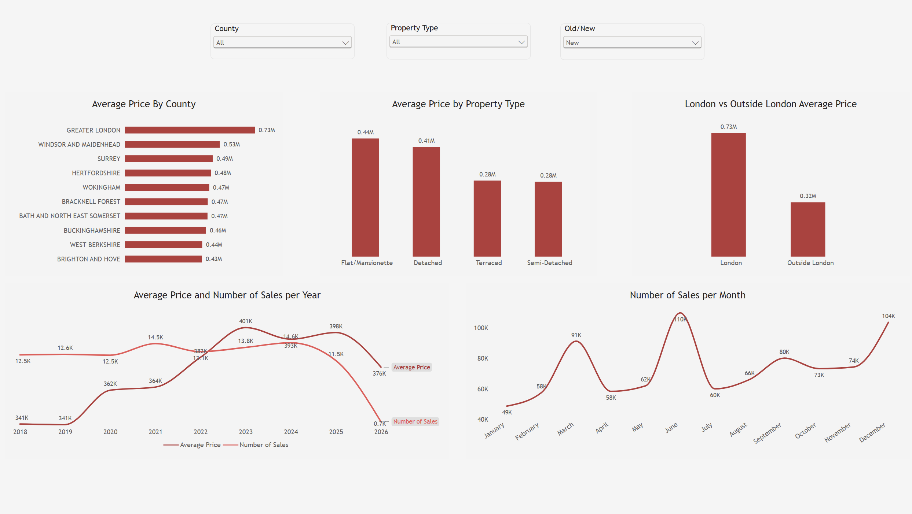

# UK Housing Price Analysis

Analysis of UK property sales from 2018 to 2026 using data from the HM Land Registry Price Paid dataset. The dataset contains over 8.5 million transactions covering England and Wales.

## Tools Used

- **Python** (Pandas, Matplotlib, Seaborn) — data analysis and visualisation
- **SQL Server** — data storage and querying
- **Power BI** — interactive dashboard
- **Docker** — running SQL Server on Mac

## Dataset

- Source: [HM Land Registry Price Paid Data](https://www.gov.uk/government/statistical-data-sets/price-paid-data-downloads)
- Size: ~8.5 million rows
- Period: 2018–2026
- Columns: Transaction ID, Price, Date, Postcode, Property Type, Old/New, Duration, Address fields, County

## Questions Explored

1. How has the average property price changed year by year?
2. Which counties have the highest average property prices?
3. Which property type commands the highest average price?
4. Which month sees the most property sales?
5. How does the average price in London compare to the rest of the UK?

## Dashboard

## Files

| File | Description |
|------|-------------|
| `analysis.ipynb` | Python analysis and charts |
| `queries.sql` | SQL queries used for analysis |
| `powerbi.png` | Dashboard screenshot |
